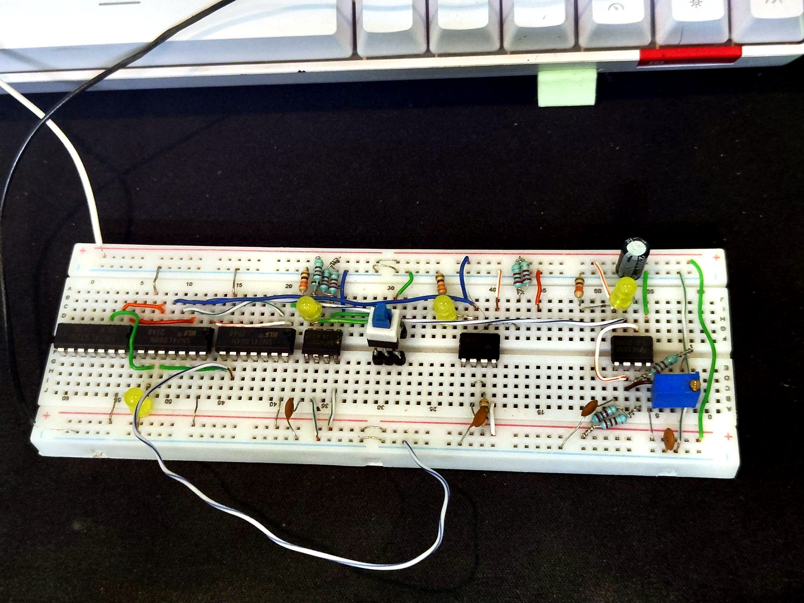
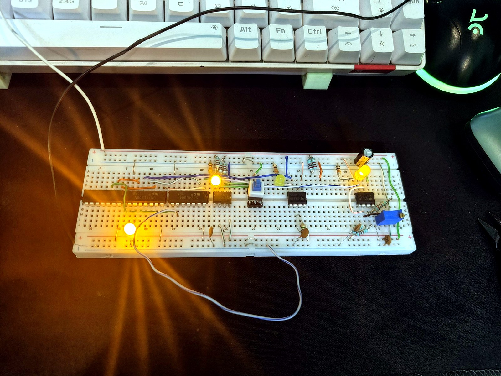

# Clock Pulse Generator

A discrete-logic clock pulse generator built on a breadboard. It produces a square-wave clock from a 555 timer in astable mode, and lets the user switch between that automatic clock and a manual push-button pulse. A HLT (halt) input stops the clock. The design is built from standard TTL logic (74LS series) and is intended as a clock source for a simple digital/CPU experiment.





## Features

- **Astable clock** from a NE555P timer, with an adjustable trimmer for frequency
- **Auto / manual select** so the clock can be stepped one pulse at a time
- **HLT (halt)** input that gates the clock off
- **Pure TTL logic** for the selector, built from 74LS04, 74LS08 and 74LS32 gates
- **LED indicators** to show the clock and control states

## How it works

The circuit has three stages:

1. **Clock source.** A 555 timer in astable mode generates a square wave. Its frequency is set by R1 and R2 (a 1 kΩ fixed resistor and a 100 kΩ trimmer or fixed resistor) and by C (1 µF).
2. **Select logic.** A select switch chooses the source:
   - When *select* is high, the astable pulse passes through AND gate A.
   - When *select* is low, the NOT gate inverts it, and AND gate C passes the manual push-button pulse instead.
   - OR gate combines both paths into a single line.
3. **Halt gate.** The HLT signal is inverted and combined with the OR output in a final AND gate. When HLT is high, the output is forced low and the clock stops.

For a full block-level view, see [`docs/schematics/clock_pulse_generator_schematic.svg`](docs/schematics/clock_pulse_generator_schematic.svg).

### Frequency

For the 555 astable configuration:

```
f ≈ 1.44 / ((R1 + 2·R2) · C)
```

With R1 = 1 kΩ, R2 = 100 kΩ and C = 1 µF:

```
f ≈ 1.44 / ((1k + 200k) · 1µF) ≈ 7.2 Hz
```

Adjusting the trimmer changes R2 and therefore the frequency. Real values vary with component tolerance, so measure the output if you need an exact figure.

## Repository layout

```
clock-pulse-generator/
├── README.md
├── LICENSE
├── .gitignore
├── docs/
│   ├── circuit-notes.md          # Design notes, timing and debugging tips
│   ├── images/                   # Breadboard photos
│   └── schematics/
│       └── clock_pulse_generator_schematic.svg
└── hardware/
    └── bom.md                    # Bill of materials
```

## Bill of materials

See [`hardware/bom.md`](hardware/bom.md) for the full list.

## Build notes

- Connect VCC (+5 V) and GND to every IC. Pin 14 (VCC) and pin 7 (GND) on the 14-pin 74LS parts, and pin 8 (VCC) and pin 1 (GND) on the 555 (check the datasheet for the package you have).
- Place a 0.1 µF ceramic capacitor between VCC and GND close to each IC to reduce noise.
- Tie unused gate inputs to a defined level. Never leave them floating.
- Add a debounce circuit to the manual push button to avoid multiple pulses from one press.

More detail is in [`docs/circuit-notes.md`](docs/circuit-notes.md).

## Usage

1. Power the board with a regulated 5 V supply.
2. Set the select switch to **auto** to run the astable clock. Adjust the trimmer to change the speed.
3. Set the select switch to **manual** and press the push button to step the clock one pulse at a time.
4. Assert HLT to stop the clock.

## Roadmap

- [ ] Add a pin-level wiring schematic
- [ ] Add a debounced push-button circuit
- [ ] Add a timing diagram for auto and manual modes
- [ ] Add a NAND-only version of the selector

## License

Released under the MIT License. See [`LICENSE`](LICENSE).
